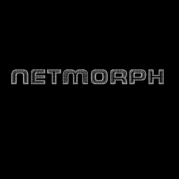

<div align="center">

# 🔥 NETMORPH

### Plateforme SaaS de Migration & Gestion de Firewall

[](https://python.org)
[](https://flask.palletsprojects.com)
[](LICENSE)

**Migrez vos configurations firewall entre WatchGuard et pfSense en quelques clics.**



---

</div>

## 📋 Sommaire

- [Présentation](#-présentation)
- [Fonctionnalités](#-fonctionnalités)
- [Architecture](#-architecture)
- [Installation](#-installation)
- [Déploiement](#-déploiement-production)
- [Configuration](#-configuration)
- [Utilisation](#-utilisation)
- [API REST](#-api-rest)
- [Sécurité](#-sécurité)
- [Équipe](#-équipe)

---

## 🎯 Présentation

**NETMORPH** est une application web développée dans le cadre d'un **Projet Tutoré à l'IUT de Valence** (2025-2026). Elle permet aux administrateurs réseau de :

- **Visualiser** les configurations firewall WatchGuard et pfSense
- **Migrer** automatiquement les règles d'un équipement à l'autre
- **Éditer** les politiques de sécurité via une interface moderne
- **Auditer** la configuration pour détecter les failles de sécurité

> 🚀 Conçu pour simplifier la transition entre équipements réseau sans intervention manuelle fastidieuse.

---

## ✨ Fonctionnalités

### 📊 Dashboard
- Parsing complet des fichiers XML WatchGuard et pfSense
- Visualisation des interfaces réseau, règles de filtrage, NAT/port-forwarding et alias
- Statistiques en temps réel

### 🛡️ Éditeur Rapide
- Création de règles de filtrage (allow/deny)
- Ajout d'interfaces réseau et de VLANs
- Suppression de règles existantes
- Support complet des services réseau (HTTP, HTTPS, DNS, RDP, SSH, etc.)

### 🔄 Migrateur Cross-Vendor
- **WatchGuard → pfSense** : traduction complète des politiques
- **pfSense → WatchGuard** : migration inverse
- Détection automatique du type source
- Migration des règles, alias, VLANs et NAT
- Auto-réparation IA des XML invalides (via Google Gemini)

### 🔍 Audit de Sécurité
- Détection des règles trop permissives (any → any)
- Vérification des services exposés
- Analyse des configurations NAT
- Rapport de vulnérabilités avec niveaux de criticité

---

## 🏗️ Architecture

```
App_V3/
├── app.py              # Point d'entrée Flask — routes & auth
├── engine.py           # Moteur de migration & injection de règles
├── parser.py           # Parsing XML WatchGuard & pfSense
├── audit.py            # Module d'audit de sécurité
├── ui_template.py      # Génération HTML/CSS/JS du dashboard
├── utils.py            # Helpers session-aware (multi-tenant)
├── logo.png            # Logo NETMORPH
├── requirements.txt    # Dépendances Python
└── template/
    ├── Template_Firebox.xml   # Template WatchGuard vierge
    └── Template_pfsense.xml   # Template pfSense vierge
```

### Stack technique
| Composant | Technologie |
|-----------|-------------|
| Backend | Python 3.10+ / Flask |
| Frontend | HTML/CSS/JS (intégré, sans framework) |
| Parsing XML | `xml.etree.ElementTree` + `lxml` |
| IA (optionnel) | Google Gemini 1.5 Flash |
| Serveur WSGI | Gunicorn |
| Reverse Proxy | Nginx + SSL |

---

## 🚀 Installation

### Prérequis
- Python 3.10+
- pip

### Installation locale

```bash
# Cloner le repo
git clone https://github.com/Ilyesse26100/NETMORPH.git
cd NETMORPH

# Environnement virtuel
python -m venv venv
source venv/bin/activate    # Linux/Mac
# venv\Scripts\activate     # Windows

# Dépendances
pip install flask gunicorn google-generativeai lxml

# Lancer
python app.py
```

L'application est accessible sur `http://127.0.0.1:5000`

---

## 🌐 Déploiement Production

### Avec Gunicorn + Nginx (recommandé)

```bash
# Lancer Gunicorn en arrière-plan
gunicorn -w 2 -b 127.0.0.1:5000 app:app --daemon
```

### Configuration Nginx

```nginx
server {
    listen 443 ssl;
    server_name netmorph.example.com;

    ssl_certificate /etc/ssl/certs/netmorph.crt;
    ssl_certificate_key /etc/ssl/private/netmorph.key;

    location / {
        proxy_pass http://127.0.0.1:5000;
        proxy_set_header Host $host;
        proxy_set_header X-Real-IP $remote_addr;
        proxy_set_header X-Forwarded-Proto $scheme;
        client_max_body_size 32M;
    }
}
```

### Service systemd

```bash
sudo tee /etc/systemd/system/netmorph.service << 'EOF'
[Unit]
Description=NETMORPH Flask App
After=network.target

[Service]
User=root
WorkingDirectory=/root/netmorph
ExecStart=/root/netmorph/venv/bin/gunicorn -w 2 -b 127.0.0.1:5000 app:app
Restart=always

[Install]
WantedBy=multi-user.target
EOF

sudo systemctl enable netmorph --now
```

---

## ⚙️ Configuration

### Variables d'environnement

| Variable | Description | Défaut |
|----------|-------------|--------|
| `SECRET_KEY` | Clé secrète Flask pour les sessions | `netmorph-dev-secret` |
| `GEMINI_API_KEY` | Clé API Google Gemini (optionnel) | *(désactivé)* |

### Auto-réparation IA (optionnel)

Pour activer la correction automatique des XML invalides après migration :

```bash
export GEMINI_API_KEY="votre_cle_api"
```

Obtenir une clé : [aistudio.google.com](https://aistudio.google.com)

---

## 📖 Utilisation

### 1. Connexion
Accédez à l'application et connectez-vous avec vos identifiants.

### 2. Import d'une configuration
- Cliquez sur **"Importer un fichier XML"** sur la page d'accueil
- Sélectionnez un fichier XML WatchGuard (`.xml` avec balise `<profile>`) ou pfSense (`<pfsense>`)
- Le dashboard s'affiche automatiquement

### 3. Migration
- Allez dans l'onglet **Migrateur**
- Cliquez sur **"Détecter la source"**
- Sélectionnez la destination (WatchGuard ou pfSense)
- Lancez la migration

### 4. Export
- Cliquez sur **"Exporter le XML"** dans la sidebar
- Importez le fichier dans votre équipement cible

---

## 🔌 API REST

| Méthode | Endpoint | Description |
|---------|----------|-------------|
| `GET` | `/` | Dashboard principal |
| `POST` | `/upload` | Import fichier XML |
| `GET` | `/export` | Téléchargement XML |
| `POST` | `/api/add_rule` | Ajout d'une règle |
| `POST` | `/api/add_interface` | Ajout d'une interface |
| `POST` | `/api/delete_rule` | Suppression d'une règle |
| `GET` | `/api/pick_source` | Détection type source |
| `POST` | `/api/migrate` | Lancement migration |
| `GET` | `/api/audit` | Résultats d'audit |

---

## 🔒 Sécurité

- **Authentification** : login/password requis sur toutes les routes
- **Sessions isolées** : chaque utilisateur a son propre espace de travail
- **Nettoyage automatique** : les sessions de plus de 24h sont supprimées
- **HTTPS** : support SSL via Nginx reverse proxy
- **Clés API** : stockées en variables d'environnement, jamais dans le code

